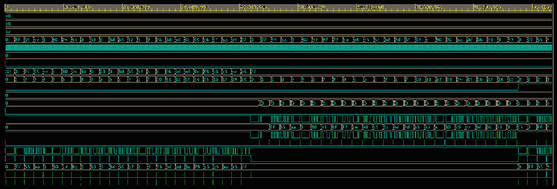

# UART Transmitter and Receiver (Verilog HDL)

A modular UART transmitter and receiver in Verilog for the standard **8N1** frame: 8 data bits, no parity, 1 stop bit. The RTL is split into independent transmitter, receiver, and top-level modules.

**Result:** all tests pass on Cadence Xcelium (EDA Playground).

---

## UART frame (8N1)

```
 idle | start | D0  D1  D2  D3  D4  D5  D6  D7 | stop | idle
  1   |   0   | <---- 8 data bits, LSB first -> |  1   |  1
```

- The line stays **high** when idle.
- The **start bit (0)** tells the receiver a byte is coming.
- Data is sent **LSB first**.
- The **stop bit (1)** ends the frame, so one byte takes 10 bit-times.

**Baud rate:** each bit is held for `CLKS_PER_BIT` clock cycles.

```
CLKS_PER_BIT = clock frequency / baud rate = 50 MHz / 115200 = 434
```

---

## Design

The UART is now split into three RTL files:

```
rtl/
├── uart_tx.v    UART transmitter
├── uart_rx.v    UART receiver
└── uart_top.v   Top-level module
```

### Transmitter: `uart_tx.v`

- On `tx_start`, it loads the byte into the transmitter.
- Generates the start bit, 8 data bits (LSB first), and stop bit.
- A baud counter holds each bit for `CLKS_PER_BIT` clock cycles.
- `tx` idles high.
- `tx_busy` is high while sending.
- `tx_done` pulses for 1 clock after the stop bit.

### Receiver: `uart_rx.v`

- Uses a **2-flip-flop synchronizer** because `rx` is asynchronous to `clk`.
- Detects the start bit and samples it near the middle of the bit period.
- Samples each data bit once per bit period.
- Receives data **LSB first**.
- Rejects glitches that do not contain a valid start bit.
- If the stop bit is 1, `rx_valid` pulses for one clock and `rx_data` contains the received byte.
- If the stop bit is 0, `frame_err` pulses for one clock.

### Top: `uart_top.v`

The new top-level module instantiates both `uart_tx` and `uart_rx` and provides a single interface for the complete UART.

| Port | Dir | Description |
|------|-----|-------------|
| `clk` | in | System clock |
| `rst` | in | Synchronous active-high reset |
| `tx_start` | in | 1-clock pulse to start transmission |
| `tx_data[7:0]` | in | Byte to transmit |
| `tx` | out | UART serial output |
| `tx_busy` | out | High while transmitter is busy |
| `tx_done` | out | 1-clock transmission-complete pulse |
| `rx` | in | UART serial input |
| `rx_data[7:0]` | out | Received byte |
| `rx_valid` | out | 1-clock pulse when a valid byte is received |
| `frame_err` | out | 1-clock pulse when the stop bit is invalid |

### Example instantiation

```verilog
uart_top #(
    .CLKS_PER_BIT(434)
) uart_inst (
    .clk(clk),
    .rst(rst),
    .tx_start(tx_start),
    .tx_data(tx_data),
    .tx(tx),
    .tx_busy(tx_busy),
    .tx_done(tx_done),
    .rx(rx),
    .rx_data(rx_data),
    .rx_valid(rx_valid),
    .frame_err(frame_err)
);
```

---

## Verification

The testbench is self-checking and verifies the UART using five directed tests:

| # | Test | What it checks |
|---|------|----------------|
| 1 | TX | DUT transmits and the testbench decodes the `tx` line |
| 2 | RX | Testbench drives a valid frame into `rx` |
| 3 | Loopback | `tx` is connected directly to `rx` |
| 4 | Framing error | Invalid stop bit raises `frame_err` |
| 5 | Glitch | Short noise pulse is ignored |

**Test bytes:** `00`, `FF`, `55`, `AA`, `01`, `80`, plus random bytes. The testbench uses `CLKS_PER_BIT = 16` to keep simulation fast.

### Simulation output

```
Test 1: TX
Test 2: RX
Test 3: Loopback
Test 4: Framing error
Test 5: Glitch
ALL UART TESTS PASSED
Simulation complete via $finish(1) at time 133475 NS + 0
```

### Waveform



- **Test 1:** `tx` carries each transmitted byte.
- **Test 2:** the testbench drives `rx`, and `rx_data` follows the transmitted bytes.
- **Test 3:** loopback connects `tx` directly to `rx`.

---

## How to run

1. Open [EDA Playground](https://www.edaplayground.com/).
2. Add the three RTL files from `rtl/` to the **Design** section:
   - `uart_tx.v`
   - `uart_rx.v`
   - `uart_top.v`
3. Add the UART testbench from `tb/` to the **Testbench** section.
4. Select **Cadence Xcelium** as the simulator and enable **Open EPWave after run**.
5. Click **Run**.
6. The log should end with `ALL UART TESTS PASSED`.

---

## Files

```
rtl/
├── uart_tx.v       UART transmitter
├── uart_rx.v       UART receiver
└── uart_top.v      Top-level UART module

tb/
└── uart_tb.v       Self-checking testbench

docs/
└── waveform.png    Simulation waveform from the current modular RTL
```

## Author

**R S Muthu Mitrn**
